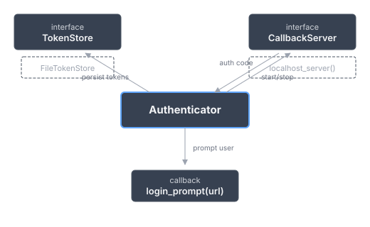
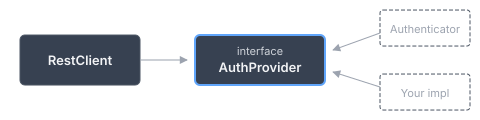

Authentication
==============

Schwab uses OAuth2 with a 30-minute access token and a 7-day refresh
token. Sectorem's auth layer manages this lifecycle automatically.

Components
----------

The :class:`~sectorem.auth.manager.Authenticator` orchestrates three pluggable
pieces:

- **TokenStore** — persists tokens across restarts. The built-in
  :class:`~sectorem.auth.token.FileTokenStore` writes JSON to disk;
  implement :class:`~sectorem.auth.token.TokenStore` for other backends.
- **CallbackServer** — receives the OAuth redirect from Schwab.
  The default :func:`~sectorem.auth.server.localhost_server` runs HTTPS
  on ``127.0.0.1:8443`` with a bundled self-signed certificate.
- **login_prompt** — an async callback that presents the
  authorization URL to the user. Defaults to printing to stdout.
- **on_authorized** — an optional async callback, called with the new
  refresh token's expiry once the user completes an authorization.

The rest of the library never touches the Authenticator directly.
It depends only on the :class:`~sectorem.auth.manager.AuthProvider` interface:

This means you can swap in your own token source without changing
any client code.

Token Lifecycle
---------------

The :class:`~sectorem.auth.manager.Authenticator` handles all stages of the
token life cycle:

- **Refreshes** the access token ~60 seconds before it expires
  (configurable via ``access_refresh_buffer``).
- **Prompts** for re-authorization one day before the refresh token
  expires (configurable via ``reauth_threshold``).
- **Raises** :class:`~sectorem.errors.NotAuthenticatedError` on API
  calls if the refresh token has fully expired, until the user
  completes re-authorization.

Tokens are persisted via a :class:`~sectorem.auth.token.TokenStore` backend.
The built-in :class:`~sectorem.auth.token.FileTokenStore` writes JSON to disk
using aiofiles. The file is private to its owner (``0600``) unless a wider
``mode`` is given, e.g. ``FileTokenStore(path, mode=0o640)`` to let the group,
or a POSIX ACL entry, read it.

Custom Auth Provider
--------------------

The :class:`~sectorem.auth.manager.Authenticator` is decoupled from the rest of
the code meaning that the API clients can be used without it. Instead, they
depend only on the :class:`~sectorem.auth.manager.AuthProvider` interface,
which requires a single async method: ``get_access_token()``.

If you need to separate token acquisition from consumption (e.g. one service
handles login, many services use the token), implement
:class:`~sectorem.auth.manager.AuthProvider`::

    from sectorem.auth import AuthProvider
    from sectorem.errors import NotAuthenticatedError

    class RedisAuthProvider(AuthProvider):
        def __init__(self, redis):
            self._redis = redis

        async def get_access_token(self) -> str:
            token = await self._redis.get("schwab:access_token")
            if token is None:
                raise NotAuthenticatedError("No token in Redis")
            return token

Then pass it to any client::

    auth = RedisAuthProvider(redis)
    trader = TraderClient(auth)

Custom Callback Server
----------------------

The default callback server uses HTTPS on ``127.0.0.1:8443`` with a
bundled self-signed certificate, but the whole thing is pluggable via
:class:`~sectorem.auth.server.CallbackServer`. For example, if you are already
using this library inside a web application and don't want to start a separate
server just for the authentication callback, you would just subclass
``CallbackServer`` and wire the callback into your existing code.

- Running behind a reverse proxy that terminates TLS and forwards to an
  internal HTTP server. 

To use your own server (e.g. behind
a reverse proxy or integrated into an existing web app), implement
:class:`~sectorem.auth.server.CallbackServer` and pass a factory to the
:class:`~sectorem.auth.manager.Authenticator`::

    from sectorem.auth import Authenticator, CallbackServer

    class MyCallbackServer(CallbackServer):
        @property
        def url(self) -> str:
            return "https://myapp.example.com/schwab/callback"

        async def start(self) -> None:
            pass  # already running

        async def stop(self) -> None:
            pass

    async def my_server_factory(callback):
        server = MyCallbackServer()
        # Wire `callback` into your existing route handler
        return server

Call ``callback`` with the redirect's query parameters. It returns a
:class:`~sectorem.auth.server.CallbackResult` saying what happened: tokens
obtained, the redirect ignored (an out-of-date, reused or forged link, judged
by the OAuth ``state``), access declined, or the code exchange failed (e.g. the
code expired). In the last two cases a new authorization URL has already been
sent to the login prompt. Show the person something that matches;
``CALLBACK_RESPONSES`` holds the default status and text for each result.

    auth = Authenticator(
        app_key="...",
        app_secret="...",
        token_store=store,
        server_factory=my_server_factory,
    )

Custom Login Prompt
-------------------

By default, the :class:`~sectorem.auth.manager.Authenticator` prints the
authorization URL to stdout. You can replace this with any async callable
that takes the URL and when the current refresh token expires (``None`` if
there is none or it has already expired) — open a browser, send a push
notification, post to Slack, whatever fits your workflow::

    import webbrowser

    async def browser_prompt(url: str, deadline: datetime | None) -> None:
        webbrowser.open(url)

    auth = Authenticator(
        app_key="...",
        app_secret="...",
        token_store=store,
        login_prompt=browser_prompt,
    )

A bound method works too::

    class MyApp:
        async def on_schwab_login(self, url: str, deadline: datetime | None) -> None:
            await self.notify_user(f"Please authorize by {deadline}: {url}")

    app = MyApp()
    auth = Authenticator(..., login_prompt=app.on_schwab_login)

Sharing Tokens Through 1Password
--------------------------------

:mod:`sectorem.auth.onepass` keeps the token in a 1Password item so that
several processes or hosts can use one Schwab login. One process, the
*writer*, runs an :class:`~sectorem.auth.manager.Authenticator` that stores its
token in the item: it refreshes the access token every 30 minutes and handles
the weekly re-authorization. Every other process is a *reader*: it reads the
access token from the item and never contacts Schwab's token endpoint.

Install the extra::

    pip install sectorem[onepass]

The item is an *API Credential* holding the Schwab app key in its
``username`` field and the app secret in its ``credential`` field. The writer
adds a concealed ``token`` field the first time it saves a token, or updates
the existing one in place, keeping its type. There must be only one field
titled ``token``. To use other field names, subclass
:class:`~sectorem.auth.onepass.OnePasswordClient` and override its
``*_FIELD_*`` attributes.

Both sides start from a :class:`~sectorem.auth.onepass.OnePasswordClient`,
which takes a service account token or a :class:`onepassword.DesktopAuth`
plus the vault and item names. The writer gets an ``Authenticator`` from
:func:`~sectorem.auth.onepass.create_authenticator`, which reads the app key
and secret from the item and passes any other arguments through::

    from sectorem import SchwabClient
    from sectorem.auth.onepass import OnePasswordClient, create_authenticator

    op = OnePasswordClient(os.environ["OP_SERVICE_ACCOUNT_TOKEN"], "trading", "schwab")
    auth = await create_authenticator(op, login_prompt=post_to_discord)

    async with SchwabClient(auth=auth) as client:
        ...

A reader uses :class:`~sectorem.auth.onepass.OnePasswordAuthProvider`::

    from sectorem.auth.onepass import OnePasswordAuthProvider, OnePasswordClient

    op = OnePasswordClient(os.environ["OP_SERVICE_ACCOUNT_TOKEN"], "trading", "schwab")

    async with SchwabClient(auth=OnePasswordAuthProvider(op)) as client:
        ...

Things to know:

- **Run exactly one writer per item.** Two writers would refresh
  independently and overwrite each other's tokens. Nothing enforces this.
- **Readers can read the whole item**, including the refresh token and the
  app secret. 1Password grants access per vault, not per field. Give readers
  a service account with read-only access to the vault, so that at least they
  cannot change the item.
- **Rate limits.** Service accounts are rate limited, and on individual and
  Families accounts all service accounts share
  `1,000 requests a day <https://developer.1password.com/docs/service-accounts/rate-limits/>`_.
  The writer makes about 48 writes a day: one per refresh, since it keeps the
  item it last read or wrote. Each reader reads the item once per access
  token, about 48 times a day, plus three requests when it starts. While no
  fresh token is available, for example while a re-authorization is pending,
  readers poll with exponential backoff, up to every 5 minutes by default
  (``max_poll_interval``).
- **Timing.** A reader looks for the next token ``refresh_buffer`` (30
  seconds) before the current one expires, and keeps returning the current
  token while it looks. The writer refreshes ``access_refresh_buffer`` (60
  seconds) before expiry, so the next token is normally already in the item
  when the reader checks. Keep the reader's buffer shorter than the writer's.
  Once the token has expired, :meth:`~sectorem.auth.onepass.OnePasswordAuthProvider.get_access_token`
  waits up to ``access_wait_timeout`` for a new one, then raises
  :class:`~sectorem.errors.NotAuthenticatedError`.
- **Failed saves.** If the writer cannot save a token, it logs the error and
  keeps using the token. Readers do not see that token, and catch up at the
  next successful save, 30 minutes later.

API Reference
-------------

.. autoclass:: sectorem.auth.AuthProvider
   :members:

.. autoclass:: sectorem.auth.Authenticator
   :members:

.. autoclass:: sectorem.auth.AuthState
   :members:
   :undoc-members:

.. autoclass:: sectorem.auth.token.Token
   :members:

.. autoclass:: sectorem.auth.token.TokenStore
   :members:

.. autoclass:: sectorem.auth.token.FileTokenStore
   :members:

.. autoclass:: sectorem.auth.server.CallbackServer
   :members:

.. autoclass:: sectorem.auth.server.AiohttpCallbackServer
   :members:

.. autofunction:: sectorem.auth.server.localhost_server

1Password
~~~~~~~~~

.. automodule:: sectorem.auth.onepass

.. autoclass:: sectorem.auth.onepass.OnePasswordClient
   :members:

.. autoclass:: sectorem.auth.onepass.OnePasswordTokenStore
   :members:

.. autoclass:: sectorem.auth.onepass.OnePasswordAuthProvider
   :members:

.. autofunction:: sectorem.auth.onepass.create_authenticator

.. autoexception:: sectorem.auth.onepass.OnePasswordLookupError
